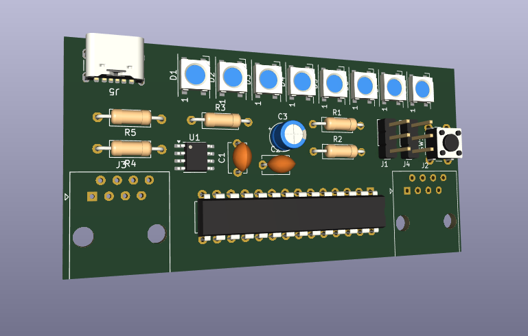
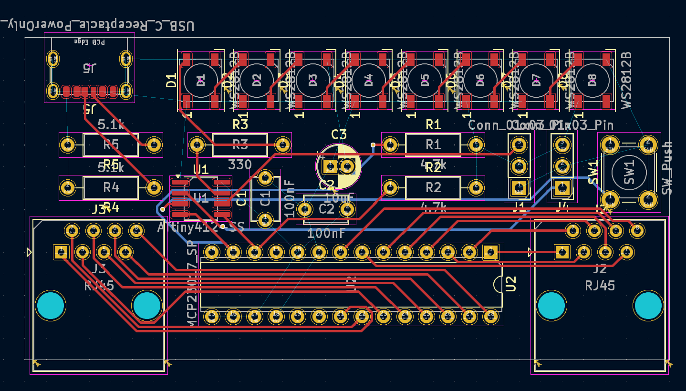
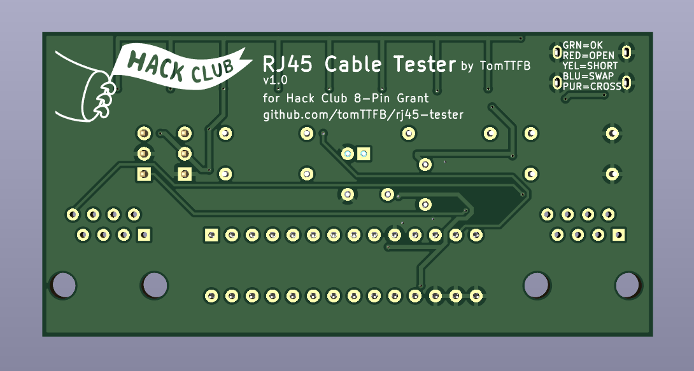
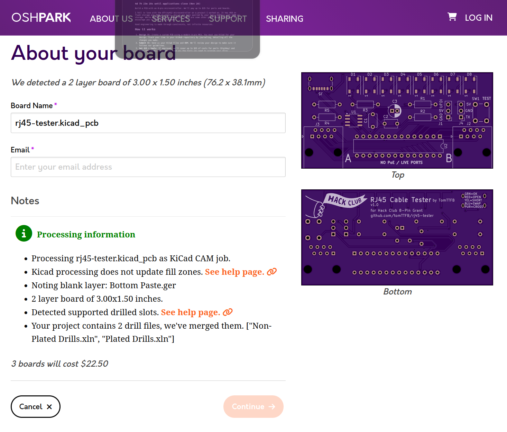
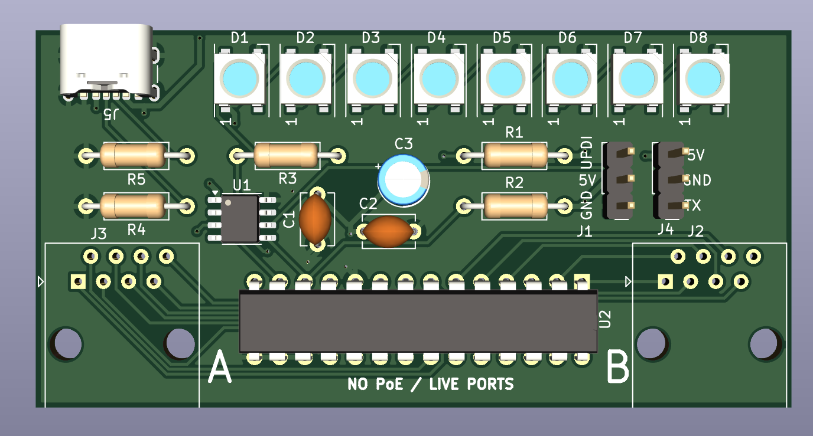

# Journal

## 21 Oct 2026 - 12:19 to 14:46 (2h 27m)
- found the ATtiny412 on mouser and checked the pinout in the datasheet
- started the schematic:
  - ATtiny412 with a cap and UPDI header
  - MCP23017 wired up with pull ups
  - both RJ45 jacks wired to the MCP23017
  - 8 WS2812B leds chained together
- fixed a few mistakes like caps in the wrong place, power pins backwards, labels swapped
- next: button, debug header and usb-c

## 5 Nov 2026 - 13:56 to 14:59 (1h 3m)
- set up the repo and journal
- added the test button
- added a debug header for serial
- added usb-c power with the 5.1k resistors
- added power flags to fix ERC errors
- ERC passes with 0 errors, schematic done
- next: pick the parts on mouser and assign footprints

## 9 Nov 2026 - 10:11 to 12:56 (2h 45m)
- I picked parts for every part of the board and added part numbers in kicad
- mouser doesn't sell bare WS2812B LEDs, so I looked at an 8mm through hole one but found two different pinouts online so went with 5050 smd ones from digikey (Inolux IN-PI55TATPRPGPB)
- I also checked the Inolux datasheet, pinout matches the WS2812B symbol (1 VDD, 2 DOUT, 3 VSS, 4 DIN)
- I picked a cheap Amphenol RJ45 jack (54602-908LF) that already has a kicad footprint
- I picked a GCT USB4125-GF-A for usb-c power, also has a kicad footprint
- I changed the debug header to 3 pins (TX, GND, 5V) so both headers are the same part
- I changed C3 to a polarised capacitor symbol since it's an electrolytic
- I assigned footprints to every part and checked them against the datasheets
- the parts for one board come to about £8.50
- next: start the PCB layout

## 15 Nov 2026 - 19:49 to 20:31 (42m)
- set up the OSH Park design rules and net classes
- pulled all the parts into the PCB editor
- tried a few layouts like a tall remote style but went back to the original one with jacks at the bottom corners, LEDs across the top and MCP23017 in the middle
- I had to squeeze everything together to get under budget so I moved C1 next to the ATtiny and C2 right above the MCP23017 power pins
- I drew the board outline, lined up the top edge with the USB-C "PCB Edge" line, jacks overhang the bottom edge slightly
- Checked it in the 3D viewer
- uploaded to OSH Park: 76.2 x 38.1mm, $22.50 for 3 boards
- budget: $22.50 PCB + about $11.32 parts =$33.82
- next: route the board

## 15 Nov 2026 - 20:45 to 22:09 (1h 24m)
- routed the LED data chain from R3 through D1 to D8
- routed all 16 jack lines from the MCP23017 to both RJ45 jacks on the front layer
- routed SDA and SCL with the pull ups, LED_DATA, UPDI and the usb-c CC resistors
- used vias and the back layer for TX and BTN so they didn't weave between the MCP23017 pins
- checked the net inspector and every signal net is routed, only +5V and GND is left
- next: route +5V and GND

## 16 Nov 2026 - 11:17 to 15:02 (3h 25m, minus 20m break)
- finished routing the +5V
- added a GND pour on both layers
- fixed unconnected stuff from DRC:
  - C1 and U2 pin 10 needed vias to the ground on the back
  - USB-C's two VBUS pads werent joined, linked them on the back layer
  - a bit of front ground got cut off by the UPDI track, added a via
- The DRC said some ground pour was too thin (0.134mm vs 0.1524mm), so I tried changing the clearance but it got worse so put it back and excluded them
- moved the LED labels off the outlines
- labelled the UPDI and serial headers (had TX and 5V backwards at first, pin 1 is the square pad)
- found the header pin labels were on the Fab layer so they wouldnt have printed, moved them to silkscreen
- added TEST on the button, A/B for the jacks and a NO PoE warning
- on the back of the board I added a hack club logo, title, my name, version, github link and a key for the LED colours
- made some text bigger and thicker because it was under osh park's minimum
- exported the BOM with part numbers, fixed two part numbers that had spaces on the end
- DRC is 0 errors 0 warnings, board is done
- next: README, check the OSH Park price again and submit

## 16 Nov 2026 - 15:02 to 15:32 (30m)
- wrote the README
- checked the OSH Park price again with the final board, still $22.50 for 3
- asked AI to review all the kicad files and it found that MCP23017 GPA7/GPB7 are output only on newer chips (datasheet rev D), so pin 8 on jack B couldnt be read
- decided to remove the TEST button and wire J2 pin 8 straight to the ATtiny PA7 instead, U2 pin 8 is now not connected
- made the button change and checked it
- removed SW1 from the BOM and updated the README
- ran ERC and DRC again, both 0 errors
- next: submit

