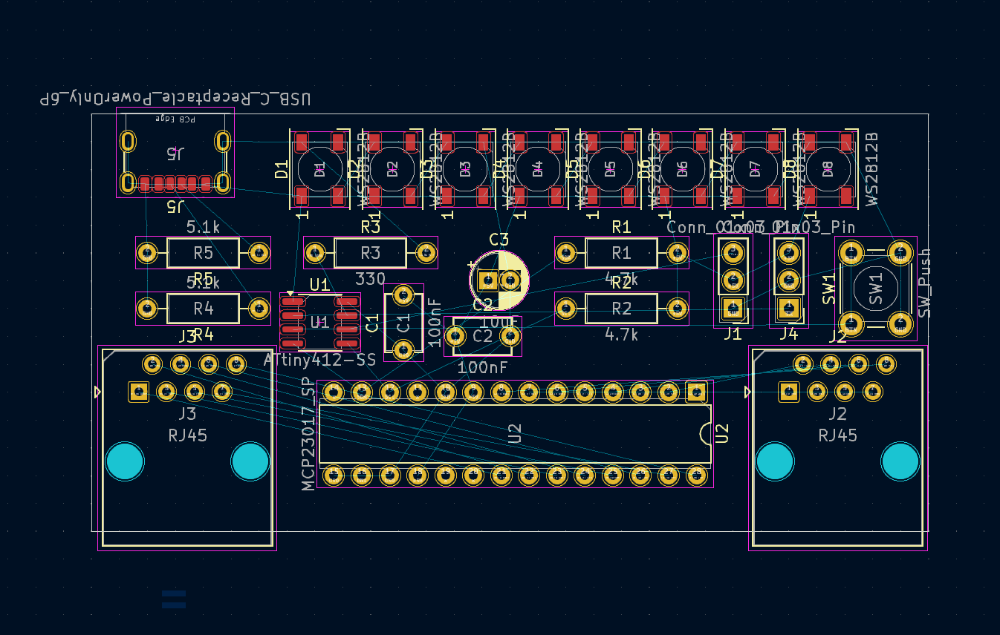
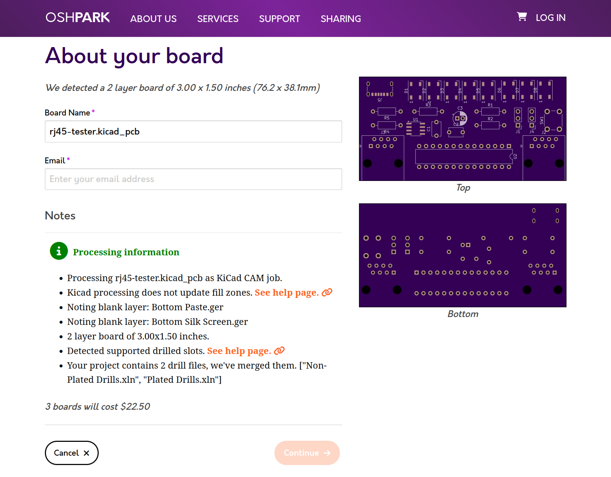

# Journal

## 21 Oct 2026 - 12:19 to 14:46 (2h 27m)
- found the ATtiny412 on mouser and checked the pinout in the datasheet
- started the schematic:
  - ATtiny412 with a cap and UPDI header
  - MCP23017 wired up with pull ups
  - both RJ45 jacks wired to the MCP23017
  - 8 WS2812B leds chained together
- fixed a few mistakes like caps in the wrong place, power pins backwards, labels swapped
- next: button, debug header and usb-c

## 5 Nov 2026 - 13:56 to 14:59 (1h 3m)
- set up the repo and journal
- added the test button
- added a debug header for serial
- added usb-c power with the 5.1k resistors
- added power flags to fix ERC errors
- ERC passes with 0 errors, schematic done
- next: pick the parts on mouser and assign footprints

## 9 Nov 2026 - 10:11 to 12:56 (2h 45m)
- I picked parts for every part of the board and added part numbers in kicad
- mouser doesn't sell bare WS2812B LEDs, so I looked at an 8mm through hole one but found two different pinouts online so went with 5050 smd ones from digikey (Inolux IN-PI55TATPRPGPB)
- I also checked the Inolux datasheet, pinout matches the WS2812B symbol (1 VDD, 2 DOUT, 3 VSS, 4 DIN)
- I picked a cheap Amphenol RJ45 jack (54602-908LF) that already has a kicad footprint
- I picked a GCT USB4125-GF-A for usb-c power, also has a kicad footprint
- I changed the debug header to 3 pins (TX, GND, 5V) so both headers are the same part
- I changed C3 to a polarised capacitor symbol since it's an electrolytic
- I assigned footprints to every part and checked them against the datasheets
- the parts for one board come to about £8.50
- next: start the PCB layout

## 15 Nov 2026 - 19:49 to 20:31 (42m)
- set up the OSH Park design rules and net classes
- pulled all the parts into the PCB editor
- tried a few layouts like a tall remote style but went back to the original one with jacks at the bottom corners, LEDs across the top and MCP23017 in the middle
- I had to squeeze everything together to get under budget so I moved C1 next to the ATtiny and C2 right above the MCP23017 power pins
- I drew the board outline, lined up the top edge with the USB-C "PCB Edge" line, jacks overhang the bottom edge slightly
- Checked it in the 3D viewer
- uploaded to OSH Park: 76.2 x 38.1mm, $22.50 for 3 boards
- budget: $22.50 PCB + about $11.32 parts =$33.82
- next: route the board

