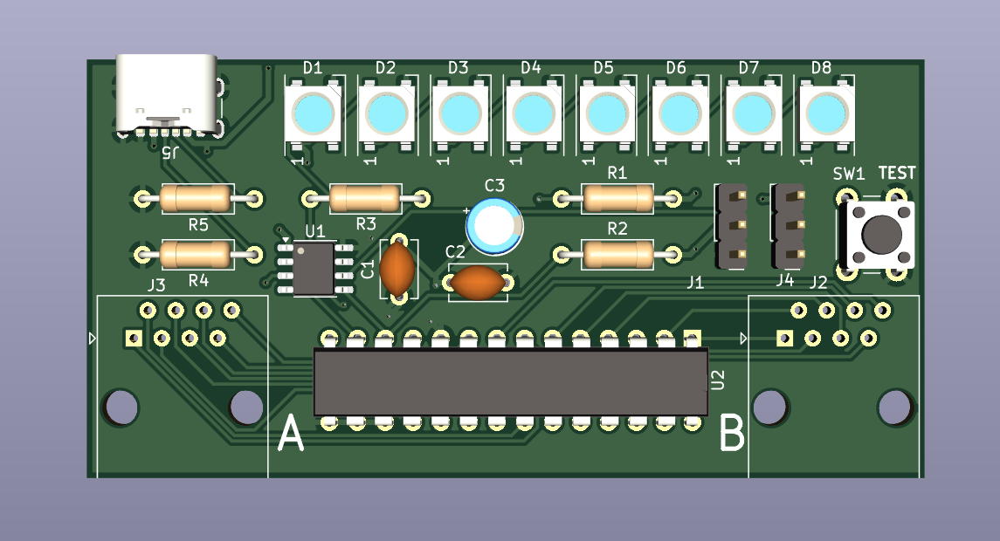
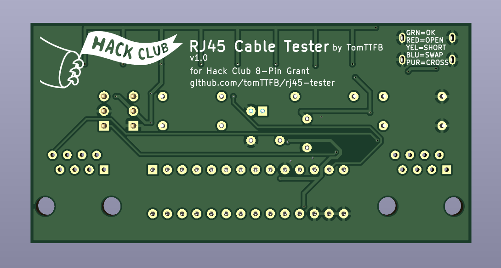

# RJ45 Cable Tester

A small board that tests ethernet cables. Plug both ends in and 8 LEDs show if each wire is working, broken, shorted or swapped.

   Made for the [Hack Club 8-Pin Grant](https://8-pin-grant.hackclub.com/)

## How It Works

- Plug one end of a cable into A and the other into B
- Tests run continuously, the LEDs update a few times a second
- The ATtiny412 drives each wire one at a time through the MCP23017 (I2C expander)
- It reads which pins come through on the other end
- J2 pin 8 is read directly by the ATtiny on PA7 because MCP23017 GPA7/GPB7 are output-only on newer chips
- The 8 LEDs show what each wire is doing

## LED Key

- Green: ok
- Red: open (broken wire)
- Yellow: short
- Blue: swapped
- Purple: crossover cable

## Parts

Full list with part numbers in the [BOM](rj45-tester/rj45-tester.csv)

- ATtiny412 (SOIC-8)
- MCP23017 I2C expander (DIP-28)
- 8x WS2812B-style LEDs (Inolux IN-PI55TATPRPGPB)
- 2x Amphenol RJ45 jacks
- USB-C (power only)

## Headers

- J1 UPDI: GND, 5V, UPDI (for programming)
- J4 serial: TX, GND, 5V

## Files

- rj45-tester/: KiCad project
- JOURNAL.md: build log

## Current Project Status

- PCB designed, DRC passed and waiting for review
- Firmware not written yet

## Warning

No PoE or live network ports, only plug in cables
